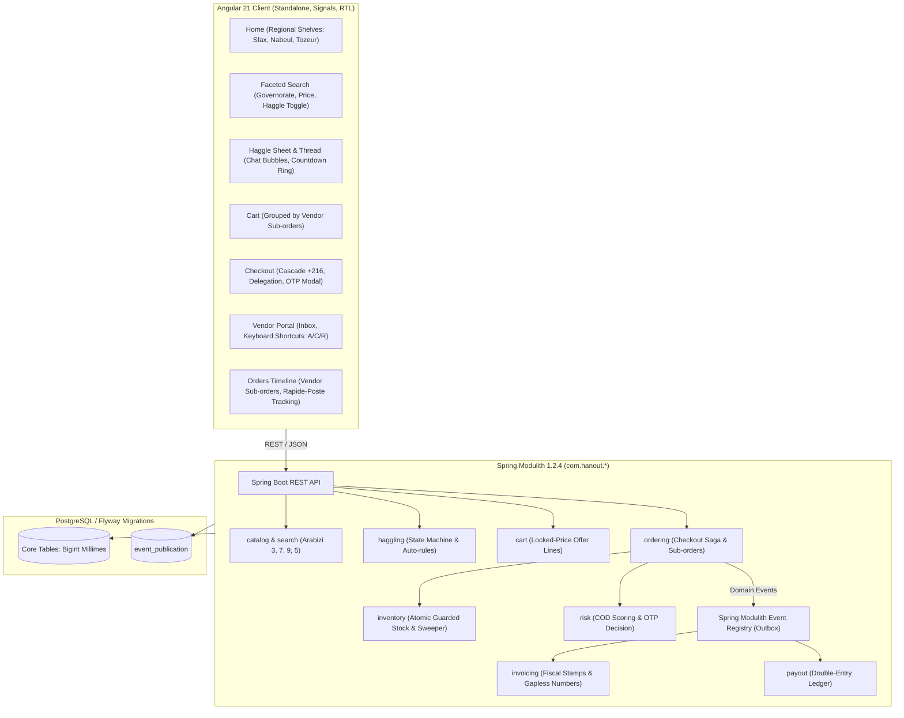
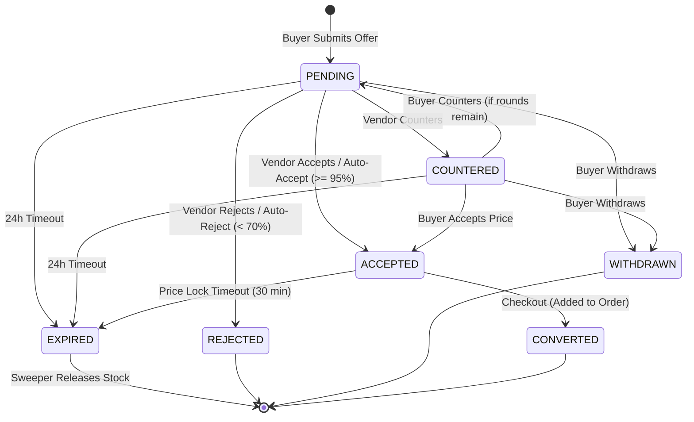

# Hanout (حانوت) - Tunisian E-Commerce Marketplace & Haggling Platform

[](https://spring.io/projects/spring-boot)
[](https://spring.io/projects/spring-modulith)
[](https://angular.dev)
[](https://tailwindcss.com)
[]()

> **Hanout** (حانوت — authentic Tunisian for "the neighborhood shop") is a modern e-commerce platform and live haggling marketplace built with a **Spring Modulith** backend and an **Angular 21** frontend.
> It models an authentic Tunisian shopping experience: live price negotiations (المساومة الحية), trilingual and Arabizi search (`zitoun`, `7rissa`, `degla`), vendor sub-orders grouped by artisan, Cash on Delivery (COD) fraud risk scoring, SMS OTP verification, and legal fiscal compliance (gapless invoice numbering, VAT breakdown, and 1.000 DT fiscal stamps).

---

## Table of Contents
1. [Architecture & System Design](#1-architecture--system-design)
2. [Frontend: Design Tokens & UI Architecture](#2-frontend-design-tokens--ui-architecture)
3. [The Haggling Engine](#3-the-haggling-engine)
4. [Backend: Modular Monolith (14 Modules)](#4-backend-modular-monolith-14-modules)
5. [Tunisian Domain Specifics](#5-tunisian-domain-specifics)
6. [Quick Start & Verification](#6-quick-start--verification)
7. [API Specification](#7-api-specification)

---

## 1. Architecture & System Design



---

## 2. Frontend: Design Tokens & UI Architecture

The frontend follows the **Spartan / shadcn** unstyled primitive philosophy paired with Tailwind CSS, strictly adhering to an **authentic Tunisian "no-slop" aesthetic** (warm lime-wash white, harissa red, saffron, olive, and Sidi Bou Said door blue).

### Color Palette Tokens

| Token | Hex | Role & Meaning in Hanout |
|---|---|---|
| `--background` | `#FBF8F3` | Warm page base, lime-wash white (*chaux*) |
| `--card` | `#FFFFFF` | Cards, modals, bottom sheets |
| `--muted` | `#F3EEE6` | Subtle fills and chips |
| `--border` | `#E6DED2` | Hairline borders (1px) |
| `--foreground` | `#1E1B18` | Warm charcoal ink (never pure black) |
| `--muted-foreground` | `#6B635A` | Secondary text, timestamps |
| `--primary` | `#B8432A` | Harissa red (primary action button CTA) |
| `--info` | `#2B5C9E` | Sidi Bou Said door blue (links, courier tracking) |
| `--success` | `#566B2F` | Mediterranean olive (in-stock, delivered) |
| `--haggle` | `#D49A2A` | Souk saffron (price negotiation badges & countdown rings) |

### Key Screens & UX Highlights
1. **Search Bar First on Home**: No generic hero banner. Prominent search with trilingual Arabizi chips (`zitoun`, `7rissa`, `degla`, `fokhar`), followed by regional shelves (*"From Sfax"*, *"From Nabeul"*, *"From Tozeur"*).
2. **Consistent 4:5 Photography**: All product photography maintains an exact `4:5` aspect ratio. Desktop cards reveal quick negotiation actions on hover; mobile cards keep actions persistently accessible.
3. **The Haggling Sheet**:
   - Bottom sheet on mobile, slide-over on desktop.
   - Quick offer discount chips: `-5%`, `-10%`, `-15%`.
   - Quantity stepper and dinar input.
   - Reply estimate banner: *"Vendor usually replies within 2 hours"*.
   - Floor price remains server-side only.
4. **Negotiation Thread & Price Lock**:
   - Chat bubbles between buyer and vendor flipping automatically under RTL.
   - Accepted offers display a live SVG countdown ring for the price lock (e.g. 30 minutes).
   - Sticky CTA: *"Add to cart at 11.000 DT"*.
   - Calm, non-alarmist explanation upon lock expiration.
5. **Cart Grouped by Artisan Sub-Orders**:
   - Cart lines are grouped by vendor, reflecting backend sub-orders.
   - Locked-price indicator badge on negotiated lines.
6. **Tunisian Address Cascade & COD Risk Modal**:
   - Governorate → Delegation → Locality cascade.
   - Strict `+216` Tunisian mobile validation.
   - If risk score dictates OTP verification, a 6-digit SMS verification modal appears seamlessly.
7. **Vendor Portal**:
   - Immediate offers inbox with keyboard shortcuts (`A` to accept, `C` to counter, `R` to reject).
   - Real-time conversion and sales metrics.
8. **Orders Timeline**:
   - Independent progression timeline per artisan sub-order.
   - Rapide-Poste tracking number and downloadable legal PDF invoice simulation.

---

## 3. The Haggling Engine

### State Machine Diagram



### Concurrency Guarantees
- **Atomic Guarded Stock Update**: Stock is only reserved upon offer acceptance (preventing lowball inventory hostage attacks):
  ```sql
  UPDATE skus 
  SET reserved = reserved + :qty 
  WHERE id = :id AND stock_on_hand - reserved >= :qty;
  ```
- **Optimistic Locking**: `@Version` column on offer entities with status checking prevent race conditions when a buyer withdraws while a vendor accepts.
- **Scheduled Sweeper**: A periodic sweeper checks `lock_expires_at < NOW()` to expire abandoned locks and release inventory back to the pool.

---

## 4. Backend: Modular Monolith (14 Modules)

Strictly enforced via Spring Modulith. The build fails if any module reaches into internal packages of another.

```
com.hanout
├── identity      # JWT auth, OTP tokens, phone verification (+216), buyer/vendor roles
├── vendor        # Artisan profiles, tax regime (flat-rate vs. VAT registered), haggling rules
├── catalog       # Products, SKUs, trilingual i18n descriptions, categories
├── search        # Arabic normalization, French unaccent, Arabizi transliteration (3, 7, 9, 5)
├── inventory     # Stock management, reservations, scheduled lock sweeper
├── haggling      # Offers state machine, auto-acceptance rules, Bucket4j rate limiting
├── cart          # Shopping cart with price-lock snapshots
├── ordering      # Checkout saga, parent orders, vendor sub-orders, price snapshotting
├── payment       # PaymentGateway port with COD, Konnect, and Flouci adapters
├── delivery      # Courier port with Rapide-Poste adapter and COD cash collection
├── risk          # Machine scoring for COD fraud detection (ALLOW / OTP / DEPOSIT / BLOCK)
├── invoicing     # Gapless per-vendor sequential numbering, VAT calculation, 1.000 DT stamp
├── payout        # Double-entry ledger (PLATFORM_COMMISSION, VENDOR_PAYABLE, COD_CLEARING)
├── notification  # SMS & Email notification ports, RTL Arabic & French templates
└── common        # Value object Money(long millimes), JPA converters, JSON serializers
```

---

## 5. Tunisian Domain Specifics

### 1. Money Value Object (`Money`)
All financial values are stored in **BIGINT millimes** (1 TND = 1,000 millimes). Doubles and floats are strictly banned to eliminate rounding drift.
```java
public record Money(long millimes) {
    public static Money ofDinar(BigDecimal dinar) {
        return new Money(dinar.multiply(BigDecimal.valueOf(1000)).longValue());
    }
    public String toDinarString() {
        return String.format(Locale.ROOT, "%.3f", millimes / 1000.0);
    }
}
```

### 2. Tunisian Seed Data
The database schema (`db/migration/V1__init_schema.sql` and `V2__seed_tunisia_data.sql`) includes:
- **24 Governorates**: Sfax, Nabeul, Tozeur, Medenine/Djerba, Tunis, Ariana, Sousse, Bizerte, etc.
- **VAT Rates**: Authentic 7% (agricultural/basic food) and 19% (crafts, processed goods, services).
- **Fiscal Stamp**: 1.000 DT (*Timbre Fiscal*) applied per legal invoice.
- **Authentic Terroir Catalog**:
  - Extra virgin olive oil from Sfax (*Huile d'olive vierge extra de Sfax*)
  - Authentic sun-dried Harissa Arbi from Nabeul (*Harissa Diari*)
  - Deglet Nour dates from Tozeur oases (*Déglet Nour de Tozeur*)
  - Traditional handmade pottery from Guellala, Djerba (*Poterie artisanale de Guellala*)

---

## 6. Quick Start & Verification

### Prerequisites
- **Java 17+**
- **Maven 3.9+**
- **Node.js 20+** & **npm 10+**

### Backend Verification & Execution
```bash
# Run all 36 backend tests (Modularity, Concurrency, Saga, Sweeper, Search)
mvn clean test -f Hanout/pom.xml

# Start the Spring Boot server (port 8080)
mvn spring-boot:run -f Hanout/pom.xml
```

### Frontend Verification & Execution
```bash
cd Hanout/frontend

# Run frontend test suite (Vitest)
ng test --watch=false

# Build production bundle
npm run build

# Start the development server
ng serve
```
Visit `http://localhost:4200` to interact with the application.

---

## 7. API Specification

| Method | Endpoint | Description |
|---|---|---|
| `GET` | `/api/v1/products?q=zitoun&lang=ar` | Trilingual & Arabizi search |
| `POST` | `/api/v1/offers` | Submit new haggling offer |
| `POST` | `/api/v1/offers/{id}/accept` | Vendor accepts offer (locks price & reserves stock) |
| `POST` | `/api/v1/offers/{id}/counter` | Vendor counters with alternative price |
| `POST` | `/api/v1/offers/{id}/reject` | Vendor rejects offer |
| `POST` | `/api/v1/offers/{id}/withdraw` | Buyer withdraws offer |
| `POST` | `/api/v1/cart/items` | Add item to cart (supports locked-price offerId) |
| `GET` | `/api/v1/cart` | Get current cart with vendor groupings |
| `POST` | `/api/v1/checkout` | Execute checkout saga with `Idempotency-Key` header |
| `POST` | `/api/v1/vendor-orders/{id}/ship` | Ship sub-order and assign Rapide-Poste tracking number |
| `GET` | `/api/v1/invoices/by-order/{id}` | Retrieve legal invoice with VAT breakdown |

---

## License
MIT License. Developed for the Tunisian Artisan & Terroir Digital Marketplace.
