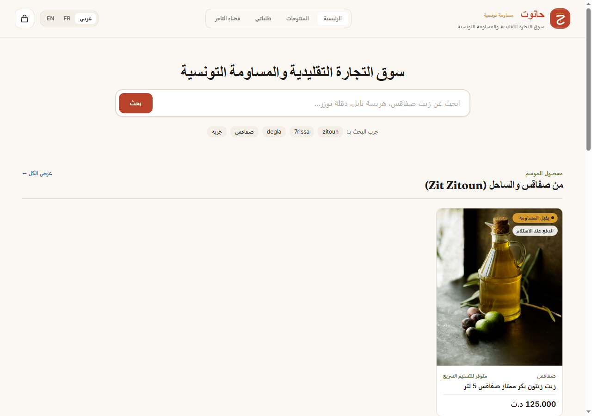
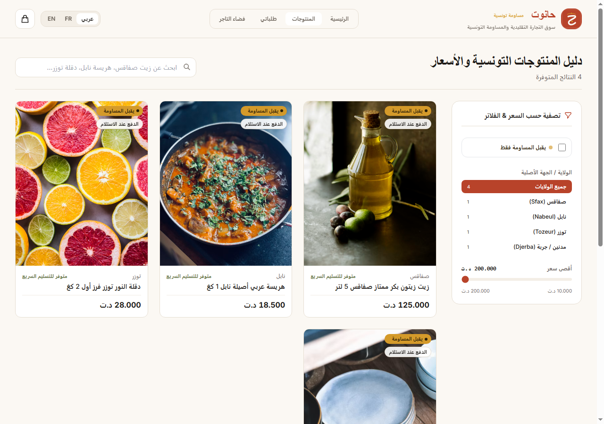
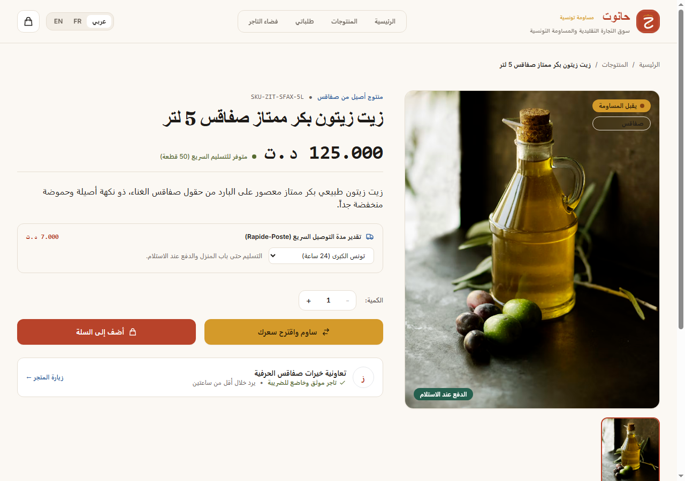
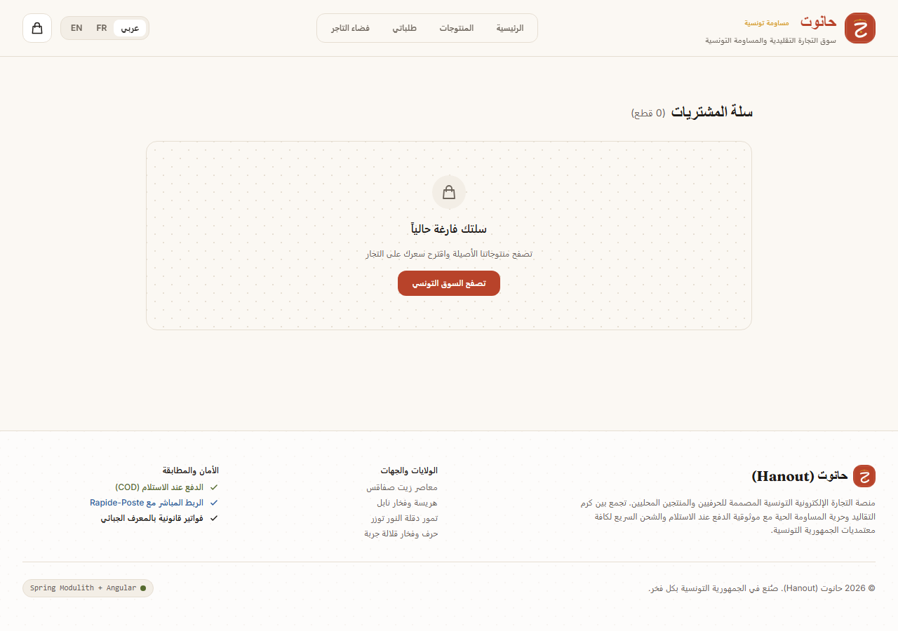
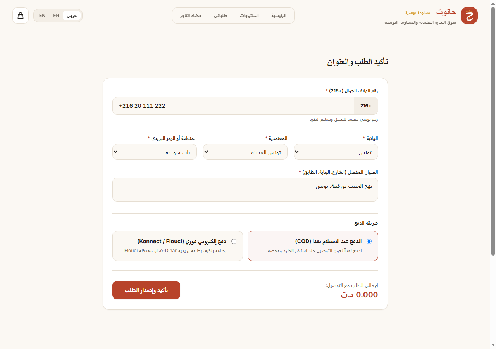
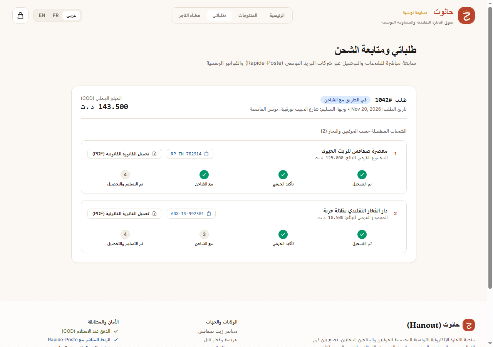
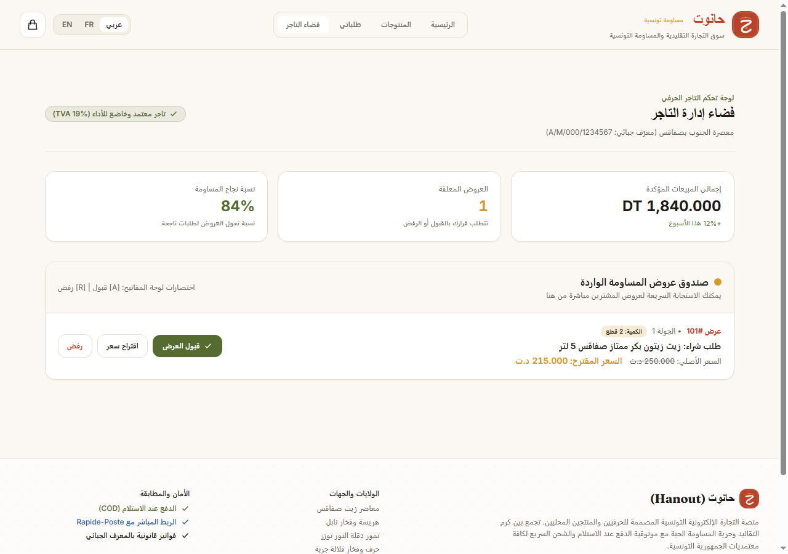
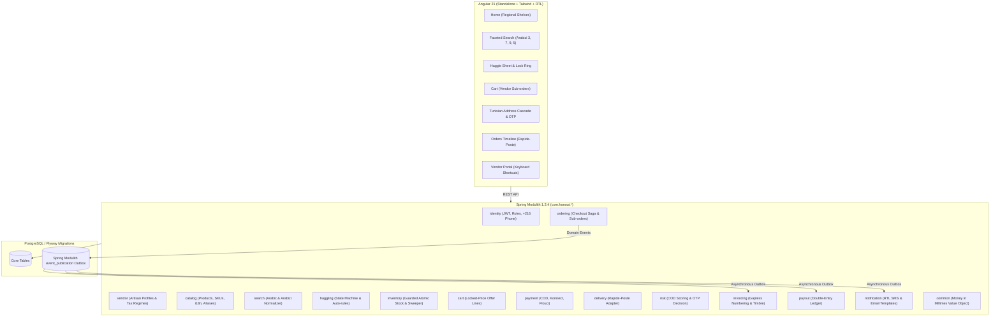

<p align="center">
  
</p>

# Hanout (حانوت) — The Soul of the Tunisian Souk, Re-engineered for Modern E-Commerce

[](https://spring.io/projects/spring-boot)
[](https://spring.io/projects/spring-modulith)
[](https://angular.dev)
[](https://tailwindcss.com)
[]()

> **حانوت (Hanout)** is more than an e-commerce platform. It is a love letter to Tunisian commercial heritage, marrying the centuries-old tradition of the souk with the precision of a high-throughput, modern modular architecture.
>
> In Tunisia, buying from a craftsman or grocer has never been a sterile, take-it-or-leave-it interaction. It is **المساومة (El Mssawma)** — a respectful, human dialogue over quality, quantity, and value. Hanout brings this living culture into the digital era with a **Spring Modulith** backend and an **Angular 21** frontend designed with a warm, "anti-slop" aesthetic that honors our Mediterranean identity.

---

## The Hanout Manifesto: Honoring Tunisian Authenticity

### 1. The Art of *El Mssawma* (المساومة الحية)
Traditional e-commerce forces rigid catalog pricing that alienates local artisans and buyers. In Hanout, **every price is a potential conversation**. Buyers propose offers with intuitive discount chips (`-5%`, `-10%`, `-15%`) or exact dinar steppers. When an artisan accepts or counters, a **live price lock** freezes inventory for that buyer, preventing disappointment while ensuring the artisan's stock is never taken hostage by lowball bids.

### 2. A Tribute to Tunisian Terroir & Craft
Hanout does not sell generic dropshipped goods. It directly empowers local producers and cooperatives across all 24 governorates:
- **صفاقس (Sfax)**: Cold-pressed extra virgin olive oil (*Zit Zitoun*) straight from Mediterranean groves.
- **نابل (Nabeul)**: Sun-cured, hand-ground authentic Harissa Arbi (*Harissa Diari*) with caraway, coriander, and garlic.
- **توزر (Tozeur)**: Export-grade translucent Deglet Nour dates (*Degla*) harvested in the lush oases of the Djerid.
- **جربة / قلالة (Djerba / Guellala)**: Millennia-old clay pottery crafted in the heritage subterranean kilns of Guellala.

### 3. The "Anti-Slop" Design Philosophy
Modern commercial apps have devolved into interchangeable corporate templates drowned in purple-to-indigo gradients, neon glows, and gimmicky emojis. Hanout rejects this trend entirely:
- **Zero Emojis Everywhere**: Real stock photography at a consistent `4:5` aspect ratio and clean vector line icons are used throughout the entire platform.
- **Page Canvas (`#FBF8F3`)**: A warm lime-wash white (*chaux / الحجر الجيري*), reminiscent of traditional Medina architecture.
- **Primary Action (`#B8432A`)**: The vibrant fiery red of fresh Cap Bon harissa (*Le rouge harissa*).
- **Haggling States (`#D49A2A`)**: The golden saffron yellow of Tunisian spice souks (*Zaâfrane*).
- **In-Stock & Delivered (`#566B2F`)**: The deep earthy green of Mediterranean olive groves.
- **Courier & Info (`#2B5C9E`)**: The iconic azure blue of Sidi Bou Said doorways.
- **Restraint & Dignity**: 1px hairline borders (`#E6DED2`), authentic product photography, and subtle low-opacity zellige geometric motifs.

---

## Frontend Showcase & Real Application Screenshots

### 1. Storefront & Regional Shelves (`/`)
The homepage bypasses generic banners and puts **Search First**. A prominent trilingual search bar supports colloquial Arabizi shortcuts (`zitoun`, `7rissa`, `degla`), followed by live cards for active negotiations and curated regional shelves from Sfax, Nabeul, and Tozeur with authentic stock photography.



---

### 2. Faceted Terroir Search (`/search`)
Instant filtering across Tunisia's authentic catalog. Filter by origin governorate (*صفاقس، نابل، توزر، مدنين/جربة*), price range slider in millimes/dinars, and an instant **"يقبل المساومة فقط" (Accepts Offers Only)** toggle.



---

### 3. Terroir Product Detail & Delivery Estimator (`/product/:slug`)
Consistent `4:5` photography showcase with vendor credential badge (*تاجر موثق وخاضع للضريبة*), Rapide-Poste delivery estimator calculated dynamically across Tunisian governorates (24h to 48h), and the signature saffron **"ساوم واقترح سعرك"** action next to **"أضف إلى السلة"**.



> **The Haggling Sheet & Live Lock**: Opening an offer triggers the bottom/side negotiation sheet with quick percentage chips (`-5%`, `-10%`, `-15%`), an exact dinar stepper, and a live circular countdown ring that locks the agreed price and reserves warehouse inventory.  
> *(Detailed diagram: [docs/screenshots/02_haggling_sheet_and_thread.svg](docs/screenshots/02_haggling_sheet_and_thread.svg))*

---

### 4. Artisan-Grouped Cart (`/cart`)
Cart items are partitioned by artisan to reflect independent shipping origins, each with its dedicated Rapide-Poste delivery allocation (7.000 DT) and saffron badges for price-locked negotiations.



---

### 5. Tunisian Address Cascade & COD Risk Shield (`/checkout`)
Streamlined checkout with Tunisian administrative divisions (**Governorate &rarr; Delegation &rarr; Locality / Postal Code**), validated `+216` mobile phone input, and Cash On Delivery payment selection. When triggered by the risk scoring engine, a 6-digit SMS OTP verification modal appears to eliminate fake orders.



---

### 6. Orders Tracking & Timeline (`/orders`)
Independent tracking progression timeline per artisan shipment (`PLACED` &rarr; `CONFIRMED` &rarr; `SHIPPED` with Rapide-Poste tracking number `RP-TN-782914` &rarr; `DELIVERED`). Includes on-demand preview of compliant Tunisian e-invoices with fiscal stamps and VAT breakdowns.



---

### 7. Artisan Portal & Keyboard-Driven Inbox (`/vendor`)
Artisan dashboard featuring real-time negotiation metrics and an incoming offers inbox with rapid keyboard triage shortcuts (`[A]` to accept and lock stock, `[C]` to counter with an alternative price, `[R]` to reject).



---

## System Architecture

Hanout is structured as a **Modular Monolith** using **Spring Modulith 1.2.4** and **Spring Boot 3.3.4**, verified at build-time with `ApplicationModules.of(HanoutApplication.class).verify()`.



---

## Engineering Rigor & Key Technical Decisions

### 1. Millimes Math — Zero Floating Point Drift
All monetary columns and calculations wrap **BIGINT millimes** inside the immutable `Money` record (1 TND = 1,000 millimes). Floats and doubles are strictly forbidden across both backend and frontend.
```java
public record Money(long millimes) {
    public static Money ofDinar(BigDecimal dinar) {
        return new Money(dinar.multiply(BigDecimal.valueOf(1000)).longValue());
    }
    public String toDinarString() {
        return String.format(Locale.ROOT, "%.3f", millimes / 1000.0);
    }
}
```

### 2. Atomic Stock Guards & Inventory Protection
Stock is reserved **only when an offer is accepted**, never on initial submission. This guarantees that malicious actors cannot paralyze a vendor's inventory with lowball offers.
The database reservation is executed with a guarded atomic update:
```sql
UPDATE skus 
SET reserved = reserved + :qty 
WHERE id = :id AND stock_on_hand - reserved >= :qty;
```
If affected rows equal 0, the stock is sold out and the acceptance is rejected cleanly.

### 3. Trilingual Arabizi Search Normalizer
Tunisians search using Arabic, French, and Arabizi numerals. Our search normalizer bridges them transparently:
- **Arabic Normalization**: Strips diacritics/tashkeel, standardizes `أ / إ / آ` &rarr; `ا`, standardizes `ة` &rarr; `ه`.
- **Arabizi Mapping**: `3` &rarr; `ع`, `7` &rarr; `ح`, `9` &rarr; `ق`, `5` &rarr; `خ`.
- **Colloquial Aliases**: `zitoun` &rarr; Sfax olive oil; `7rissa` &rarr; Nabeul harissa; `degla` &rarr; Tozeur dates.

### 4. Gapless Invoicing & Tunisian Tax Regimes
Compliant with Tunisian tax authorities (*Code de la TVA*):
- Gapless sequential invoice numbers per fiscal year (e.g., `FAC-2026-00001`).
- Accurate VAT derivation (7% for basic agricultural produce, 19% for crafts and processed goods).
- Automatic application of the legal 1.000 DT fiscal stamp (*Timbre Fiscal*).

---

## Quick Start Guide

### 1. Backend (Spring Boot + Modulith)
```bash
# Execute the comprehensive 36-test suite
mvn clean test -f Hanout/pom.xml

# Start the Spring Boot server (port 8080)
mvn spring-boot:run -f Hanout/pom.xml
```

### 2. Frontend (Angular 21 + Tailwind)
```bash
cd Hanout/frontend

# Run frontend tests (Vitest)
ng test --watch=false

# Build production distribution
npm run build

# Start live development server (port 4200)
ng serve
```
Navigate to `http://localhost:4200` to experience the platform.

---

## Automated Test Suite

| Test Suite | Scope | Result |
|---|---|---|
| `ModularityTest` | Spring Modulith architectural boundaries verification | **PASS** |
| `LastJarConcurrencyTest` | 50 concurrent threads racing for 1 final stock unit | **PASS (1 winner, 49 cleanly rejected)** |
| `OfferStateMachineTest` | Parameterized matrix of all 25 valid/invalid transitions | **PASS** |
| `SweeperTest` | Automated expiration and stock release of abandoned locks | **PASS** |
| `CheckoutSagaIntegrationTest` | Cart &rarr; Sub-orders &rarr; Risk &rarr; Invoicing &rarr; Ledger | **PASS** |
| `SearchTest` | Arabic, French, and Arabizi normalization engine | **PASS** |
| `MoneyTest` | Millimes arithmetic, VAT derivation, and 3-decimal formatting | **PASS** |
| `App.spec.ts` | Angular shell, RTL switching, and MoneyPipe format | **PASS** |

---

## REST API Reference

| Method | Endpoint | Description |
|---|---|---|
| `GET` | `/api/v1/products?q=zitoun&lang=ar` | Trilingual & Arabizi search |
| `POST` | `/api/v1/offers` | Submit new haggling offer |
| `POST` | `/api/v1/offers/{id}/accept` | Artisan accepts offer (locks price & reserves stock) |
| `POST` | `/api/v1/offers/{id}/counter` | Artisan counters with alternative dinar amount |
| `POST` | `/api/v1/offers/{id}/reject` | Artisan rejects offer |
| `POST` | `/api/v1/offers/{id}/withdraw` | Buyer withdraws offer |
| `POST` | `/api/v1/cart/items` | Add item to cart with optional negotiated price lock |
| `GET` | `/api/v1/cart` | Retrieve current cart with artisan sub-order groupings |
| `POST` | `/api/v1/checkout` | Trigger checkout saga with `Idempotency-Key` header |
| `POST` | `/api/v1/vendor-orders/{id}/ship` | Ship sub-order and generate Rapide-Poste tracking number |
| `GET` | `/api/v1/invoices/by-order/{id}` | Download legal invoice with full VAT breakdown |

---

## Built with Pride for the Tunisian Artisan Community
Designed and developed in the Republic of Tunisia.
Hanout proves that cultural authenticity and cutting-edge software architecture don't just coexist — they elevate one another.
